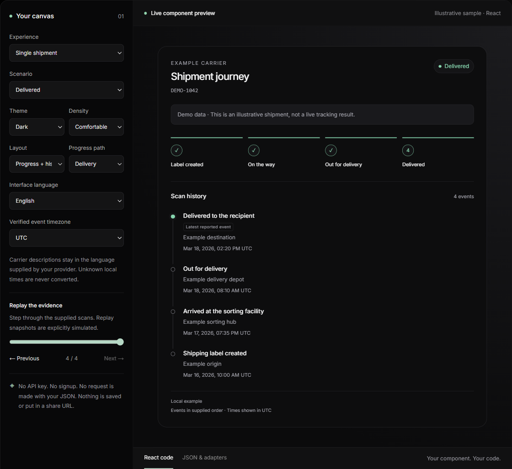
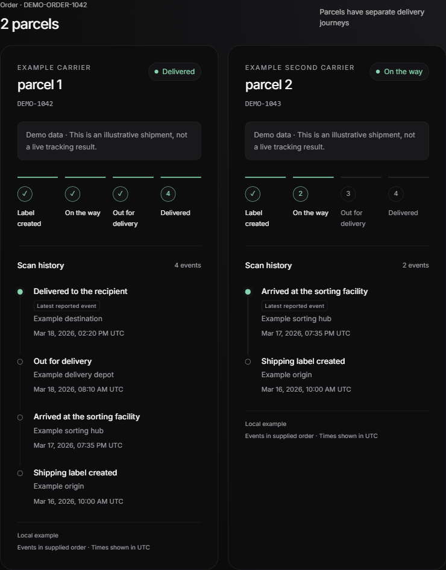

# Trace UI

Clear shipment experiences for React.

Build shipment timelines, split-order views and return journeys with the tracking
backend you already use. MIT licensed. React 18/19. TypeScript. No account is
required to render the UI.

**[Open the visual builder →](https://traceapi.dev/timeline-builder?utm_source=github&utm_medium=readme&utm_campaign=trace-ui-020)**

[Read the release walkthrough](https://traceapi.dev/blog/introducing-trace-ui?utm_source=github&utm_medium=readme&utm_campaign=trace-ui-020) — install the components, explore the difficult states, and connect the durable starter.

[Quick start](#add-it-to-your-app) · [Component reference](packages/timeline/README.md) · [Next.js starter](examples/nextjs-tracking/README.md) · [0.2.0 release](https://github.com/Foreveryoung2149/trace-ui/releases/tag/ui-v0.2.0)

[](https://traceapi.dev/timeline-builder?utm_source=github&utm_medium=readme&utm_campaign=trace-ui-020)

## Try the difficult states first

The [free builder](https://traceapi.dev/timeline-builder?utm_source=github&utm_medium=readme&utm_campaign=trace-ui-020) lets you change the layout, theme, density and language, replay fictional scans, preview a two-parcel order, validate JSON and copy working React.

- **Stale updates stay labelled.** The last known state does not become a live observation.
- **Unknown timezones stay unknown.** A local scan time is never silently converted to UTC.
- **Unavailable is a distinct state.** Failed retrieval does not become “awaiting shipment.”
- **Parcels keep separate journeys.** One delivery does not complete every parcel in an order.
- **Returns, pickup and handoffs have explicit states.** Progress is based on the data you supply.

The component makes no network requests and has no telemetry or required Trace
branding. Builder JSON stays in page memory; it is not sent to a service or put
in a share URL. Use fictional or sanitized data when sharing examples.

## Add it to your app

Install the pinned 0.2.0 package:

```sh
npm install https://traceapi.dev/downloads/traceapi-timeline-0.2.0.tgz
```

```tsx
import { ShipmentTimeline } from '@traceapi/timeline';
import { sampleShipments } from '@traceapi/timeline/samples';
import '@traceapi/timeline/styles.css';

export default function TrackingView() {
  return (
    <ShipmentTimeline
      shipment={sampleShipments.in_transit}
      theme="light"
      locale="en"
    />
  );
}
```

This renders fictional data immediately. In Next.js, import the stylesheet once
in your root `app/layout.tsx`. The components support server rendering and can
also be used in client components; there is no Tailwind dependency.

**The package is distributed as a pinned download today. npm/PyPI registry
publication is pending.** The install above works without a registry account;
do not assume `npm install @traceapi/timeline` is available yet.

### Bring your own data

Map your provider's response to the small `TimelineShipment` model. There is no
mandatory SDK, backend or carrier integration hidden in the component.

```tsx
import { ShipmentTimeline, type TimelineShipment } from '@traceapi/timeline';

// Fictional normalized data. Preserve your provider's actual evidence.
const shipment: TimelineShipment = {
  reference: 'Order #1042',
  carrier: 'Example carrier',
  status: 'in_transit',
  freshness: 'cached',
  events: [{
    description: 'Arrived at the sorting facility',
    timestamp: null,
    localTime: '2026-03-17T19:35:00',
    timezone: 'unknown',
  }],
};

export function OrderShipment() {
  return <ShipmentTimeline shipment={shipment} theme="dark" />;
}
```

Set freshness from your source/cache policy. The library preserves supplied scan
order and does not predict delivery dates. An optional `fromTraceTracking`
adapter accepts Trace data without importing the Trace SDK or making requests.
For untyped JSON, use the [runtime validation helpers](packages/timeline/README.md#validate-untyped-json-and-adapt-trace).

## Compose the experience you need

Use `ShipmentTimeline` for a complete view, or combine `TimelineFrame`,
`ShipmentSummary`, `ShipmentProgress`, `ShipmentHistory`, `FreshnessNotice`,
`ExceptionNotice` and `ShipmentFreshness`.

| Build | Start with |
| --- | --- |
| A shipment detail view | [`ShipmentTimeline`](packages/timeline/README.md) |
| A multi-parcel order page | [`OrderTracking`](packages/timeline/README.md#compose-your-own-experience) and the [order-page template](templates/OrderTrackingPage.tsx) |
| A merchant support panel | [SupportShipmentPanel](templates/SupportShipmentPanel.tsx) |
| An existing return's progress | [ReadOnlyReturnTimeline](templates/ReadOnlyReturnTimeline.tsx) |
| A custom layout | [The composable primitives](packages/timeline/README.md#compose-your-own-experience) |

Dark/light themes, compact spacing, configurable progress stages and CSS tokens
are included. English, Spanish, French and Arabic UI dictionaries are provided,
with RTL support. Carrier descriptions stay in their supplied language.



The templates render supplied data. They do not buy return labels, issue refunds
or authorize customer access. [Browse the template guide](templates/README.md).

## Run the Next.js starter

With Node 22+ and npm:

```sh
git clone https://github.com/Foreveryoung2149/trace-ui.git
cd trace-ui
npm ci
npm run dev
```

Open **http://localhost:3000**. The root demo uses local fixtures and needs no
API key, signup or database.

The [complete order starter](examples/nextjs-tracking/README.md) adds an optional
private two-parcel workflow with your own Postgres:

1. Authorize an order through a tenant-scoped customer session.
2. Verify a signed webhook's original bytes and persist the event before acknowledging it.
3. Process a durable inbox into a revisioned display projection.
4. Refresh the saved order without triggering a carrier lookup.
5. Exercise duplicate delivery, older revisions and worker restart with local fixtures.

The Basic integration-preview password never grants access to customer orders.
The starter guide explains identity provisioning, expected parcel counts,
explicit live configuration, retention and recovery boundaries.

The five-minute target is first local UI render. Database setup, identity and a
real carrier result are separate milestones. Fixtures do not establish live
source reliability.

## More free tools

- [Local webhook doctor](docs/webhook-doctor.md): inspect signatures and receiver status codes without forwarding payloads.
- [Scenario samples](packages/timeline/README.md#fixtures-and-replay): delivery, exceptions, stale/unavailable data, unknown timezones, pickup, returns, cancellation, carrier handoff and split orders.
- [75-second product walkthrough](docs/launch-demo.md): demonstrate the real builder using fictional data.

## Need a managed tracking backend?

Trace API provides persistent shipment records, normalized tracking data and
signed updates with delivery history and replay. The UI remains useful with
your own backend.

[Explore the API docs](https://traceapi.dev/docs) or
[create a Trace account](https://traceapi.dev/signup?utm_source=github&utm_medium=readme&utm_campaign=trace-ui-020).
Keep provider keys on your server. Sandbox exercises the API integration without
live carrier lookups; real tracking depends on source availability and account
allowances.

## Develop and contribute

```sh
npm test
npm run typecheck
npm run build
```

The optional database/HTTP suites use an explicitly isolated
`TRACE_STARTER_TEST_DATABASE_URL`. Tests and fictional examples do not prove
carrier accuracy or production uptime.

See [CONTRIBUTING](CONTRIBUTING.md), [security reporting](SECURITY.md),
[release instructions](RELEASING.md) and the [MIT license](LICENSE).
Please use sanitized fixtures in issues and pull requests. Never include API
keys, signing secrets, customer information or real tracking numbers.
